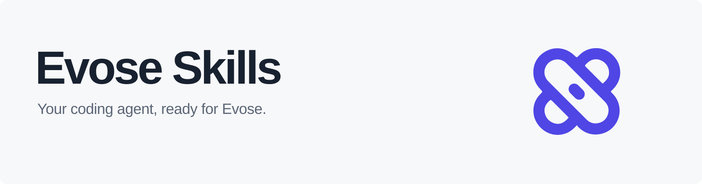
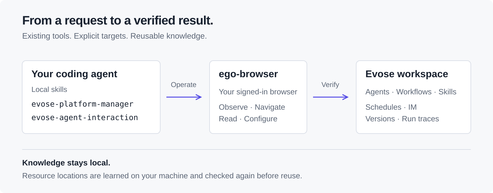

<picture>
  <source media="(prefers-color-scheme: dark)" srcset="docs/assets/hero-dark.svg">
  
</picture>

# 让你的智能体直接操作 Evose

用自然语言配置 Agent、搭建工作流、管理 Skill 和排查运行问题。操作经验留在本地，后续任务继续复用。

[](https://github.com/GarySus/evose-skills/actions/workflows/check.yml)
[](LICENSE)

[版本下载](https://github.com/GarySus/evose-skills/releases) · [npm 包](https://github.com/GarySus/evose-skills/packages) · [快速安装](#快速安装) · [使用示例](#使用示例) · [工作方式](#工作方式) · [完整文档](#完整文档)

## 快速安装

准备好 **Node.js ≥22.20、Git 和 [ego lite](https://lite.ego.app/)**，然后在终端执行：

```bash
npx --yes skills@1.7.4 add GarySus/evose-skills --skill '*' -a codex -g -y --copy
```

重新打开智能体会话，在 ego lite 登录 Evose，即可开始。首次浏览器引导与登录由你完成。

<details>
<summary>交给智能体安装：复制这句话</summary>

> 请根据 https://github.com/GarySus/evose-skills 的 README，在本机安装 Evose Skills；先检查 Node.js、Git 和 ego lite，已有依赖跳过，执行安装命令并验证两个 Skill 可用，首次浏览器引导和 Evose 登录由我完成。

</details>

<details>
<summary>Claude Code 或其他智能体</summary>

将命令中的 `-a codex` 换成 `-a claude-code`；安装到全部受支持客户端可改为 `--agent '*'`。客户端需要本地终端与文件能力，并能运行 ego-browser。

</details>

环境安装、验证命令、私有部署配置和故障排查，见[安装指南](docs/installation.md)。升级会替换同名 Skill，先备份本地修订。

## 使用示例

把工作空间或资源链接交给智能体，直接说明目标：

> 使用 evose-platform-manager，打开这个工作空间，看看有哪些 Agent、Workflow 和 Skill，先不修改配置。

> 帮我检查这个 Agent 为什么在群里不回复。先看已有运行记录，定位问题，再做最小修复。

> 优化这个 Agent 的对话体验：沿用上下文改稿，直接展示完整成品，减少重复追问。

## 工作方式

<picture>
  <source media="(prefers-color-scheme: dark)" srcset="docs/assets/how-it-works-dark.svg">
  
</picture>

| 能力 | 可以做什么 |
|---|---|
| 平台管理 | 定位资源、编辑配置、核对发布版本与能力挂载 |
| 工作流与计划 | 检查节点、变量映射、引用方向与实际运行 |
| IM 与排障 | 核对机器人身份、消息路由和追踪中的真实调用 |
| 交互评测 | 改善重复追问、改稿连续性、成品展示与失败接续 |
| 定位学习 | 记录已验证的资源位置，复用前重新核对身份与元素 |

两个 Skill 安装在本地智能体中。线上权限和业务操作范围以当前任务为准；学习记录独立保存，升级保留。

## 完整文档

- [安装与维护](docs/installation.md)：依赖、验证、私有部署、升级和卸载。
- [平台操作手册](skills/evose-platform-manager/SKILL.md)：按任务查阅导航、配置、版本、IM 与验收方法。
- [交互设计与评测](skills/evose-agent-interaction/SKILL.md)：自然语言协作、局部返工和可见交付。
- [抽离范围](docs/extraction.md) · [开发与发布](docs/publishing.md) · [MIT License](LICENSE)
